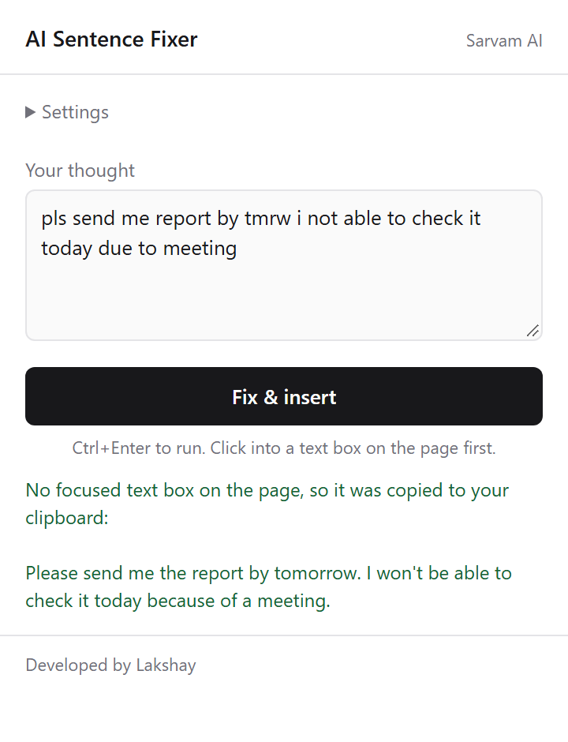

# AI Sentence Fixer (Sarvam AI)

A Chrome extension that turns a rough, broken thought into a clean, grammatical sentence using [Sarvam AI](https://www.sarvam.ai/) and types it straight into the text box where your cursor is.

## Features

- Write your thought in any form: shorthand, broken grammar, Hinglish.
- Sarvam AI fixes grammar, spelling and wording while keeping your meaning and tone.
- The result is inserted at your cursor (Gmail, Slack, LinkedIn, WhatsApp Web, plain text boxes). Selected text is replaced. Ctrl+Z undoes it where the site supports it.
- If no text box is focused, the result is copied to the clipboard.
- Your draft is kept if the popup closes, and cleared after a successful insert.
- Shortcut: **Alt+Shift+W** opens the popup, **Ctrl+Enter** runs it.

## Install

1. Download `ai-sentence-fixer-v1.0.zip` from [Releases](../../releases) and unzip it (or clone this repo).
2. Open `chrome://extensions` and turn on **Developer mode**.
3. Click **Load unpacked** and select the unzipped folder.
4. Open the extension, expand **Settings** and paste your Sarvam API key (get one at [dashboard.sarvam.ai](https://dashboard.sarvam.ai/)).

## Usage

1. Click into a text box on any page.
2. Open the extension and write your thought.
3. Press **Fix & insert** (or Ctrl+Enter).

## Privacy

- Your API key and draft are stored only in your browser (`chrome.storage.local`).
- The text you write is sent only to `api.sarvam.ai`. Nothing else is collected.

## Limitations

- Text boxes inside iframes are not filled directly; the result goes to the clipboard instead.
- Browser pages such as `chrome://` and the Chrome Web Store cannot be scripted by extensions.
